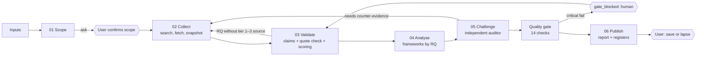

> **Status:** approved by Amit on 2026-10-25 with all recommended defaults. Where this document lists an open question or option, the decision recorded in [decisions.md](decisions.md) applies. Written during discovery, before the phase 1 build.

# Harness blueprint (target architecture)

Proposed path: `docs/harness/target-architecture.md` · Discovery draft, 25 Oct 2026 · **[Proposed] throughout; nothing here is built**

## Design stance

The smallest harness that makes master prompt v2 enforceable in code:

- **One Node process.** Reuse the root Express server (`server.js`, CommonJS, already has `/api/*` routes and a git-ignored `data/` folder). There is no framework, queue or database.
- **One model-call pattern per stage, plus a separate auditor call.** There is no multi-agent runtime. The six team roles in v2 §1 become stage prompts.
- **Files as the database.** Each study has a workspace folder with a state file, an append-only event log and snapshots.
- **Code owns the rules.** Models propose records; code scores, checks and commits them.
- **The Vantage Point UI stays as it is.** It polls the server instead of calling `window.claude`.

This matches the engine plan's four-PR sequence (clean up → stage runner without search → live sources → deploy) and adds the state, gate and eval pieces that plan does not specify.

## 1. Components and responsibilities

| Component | Responsibility | Reuses |
| --- | --- | --- |
| `server.js` (modified) | Adds `/api/studies` routes; serves the UI | Existing Express app |
| `harness/runner.js` | Execution loop: picks the next stage, runs it, evaluates the exit check, checkpoints, emits events | none |
| `harness/state.js` | Study state machine, atomic writes, event log, resume | `fs-extra` (already a dependency) |
| `harness/stages/*.js` | One module per stage: builds context, calls the model with its allowlisted tools, validates the output against the schema | Vantage Point prompts (`RULES`, `LEAD`, reply shapes) as the starting point |
| `harness/scoring.js` | v2 §6B formula, penalties, label bands, weakest link | v2 worked examples as tests |
| `harness/gates.js` | Stage exit checks (v2 §4) and the 14 quality-gate checks (mechanical ones in code; judged ones read from the auditor's output) | v2 §12 |
| `harness/tools/llm.js` | Model calls with timeout, retry, cost meter, response recording | Replaces `aiClient.js` live path |
| `harness/tools/search.js` | Search adapter, provider set in config | Provider pending (G22) |
| `harness/tools/fetch.js` | Fetch → snapshot + sha256 + robots check; archive attempt | none |
| `harness/config.json` | Budgets, retries, tier table, Verified rule, critical checks, material threshold, model and provider names | Values come from the decisions below, not invented |
| `harness/schema/study.schema.json` | Canonical study record (output-contract §2) | xlsx headers |
| `harness/prompts/*.vN.md` | Versioned stage prompts ("skills") | master prompt v2 sections |
| `harness/eval/` | Fixtures, planted-error cases, frozen snapshots, `run-eval.js` | Golden case and Samsung registers |
| `mci-web/` or the Vantage Point page | UI: stepper, ask card, report, claim register | Vantage Point page as-is; React port later (engine plan step 1) |

## 2. Task state model

**Study state** (stored in `study.json`, mirrored to the UI's four stage states):

```
created ─▶ scoping ─▶ needs_input ─(user answers)─▶ collecting ─▶ validating ─▶ analysing
   ─▶ challenging ─▶ gating ─┬─▶ published            (all critical pass, no partials)
                             ├─▶ published_with_gaps  (all critical pass, partials on page one)
                             └─▶ gate_blocked ─(user: fix input / accept downgrade)─▶ validating

any running state ─(error after retries)─▶ stage_failed ─(retry)─▶ same state, from checkpoint
any running state ─(spend cap hit)──────▶ needs_input  (raise cap or stop)
validating ─(RQ lacks tier 1–3 source and budget left)─▶ collecting   (loop-back, max N)
challenging ─(auditor requests counter-evidence)──────▶ collecting   (loop-back, max N)
any ─(user)─▶ cancelled | lapsed (workspace deleted)      published* ─(user save)─▶ saved
```

There is no transition that lets a user publish over a critical Fail. The only ways out of `gate_blocked` are to correct, downgrade or remove the claim (v2 §12).

**Stage state** (the UI keeps today's labels): `pending → running → passed | attention | failed`. `attention` covers both `needs_input` and `gate_blocked`.

## 3. Execution loop

```js
async function runStudy(id) {
  let s = await state.load(id);                       // resumes from last checkpoint
  while (!TERMINAL.has(s.state)) {
    if (s.state === 'needs_input') return;            // wait for the API call from the UI
    const stage = STAGES[s.state];                    // scope | collect | ... | publish
    await events.emit(id, 'stage_start', { stage: stage.name, attempt: s.attempt });
    let out;
    try {
      const ctx = await stage.buildContext(s);        // from stored artefacts only (C1)
      out = await withRetry(() => stage.run(ctx, tools.for(stage.name)), cfg.retry);
      out = schema.validate(stage.name, out);         // reject or repair once
      out = stage.commit(s, out);                     // code scores, assigns IDs, quote check
    } catch (e) {
      s = await state.fail(s, stage.name, toRunError(e));   // never fall back to mock
      return;
    }
    await state.checkpoint(s, stage.name, out);       // atomic write + event
    const exit = gates.exitCheck(stage.name, s);      // evaluated in code
    await events.emit(id, 'exit_check', exit);
    s = await state.transition(s, nextState(stage.name, exit, s));  // advance | loop back | ask | block
    if (budget.exceeded(s)) s = await state.ask(s, 'budget');
  }
}
```

**Collect** loops internally: plan the queries for each research question, then `search`, `fetch` and snapshot, with a checkpoint after each batch. The search log is written from the tool calls, not by the model. It stops on v2's stopping rule or the budget.

**Validate** asks the model for claim records that quote passages. Code then checks each quote against its snapshot, links the sources, computes the scores and records contradictions.

**Challenge** is a fresh model call with only `{draft, sources, claims, gate_results_so_far}`. Its verdicts are applied by code.

**Publish** runs `gates.qualityGate()`, renders the report (md and html), and writes the AI-use disclosure from the events.

## 4. Workflow and dependency graph



## 5. Persistence and checkpoints

```
data/studies/<study_id>/          # git-ignored (data/ is already ignored for *.json; extend to data/studies/)
  study.json                      # canonical record; atomic write (tmp + rename)
  events.jsonl                    # append-only audit log
  stages/01-scope.json … 06-publish.json
  snapshots/<sha256>.{html,pdf} + <sha256>.meta.json   # url, accessed, status, type
  llm/<stage>-<seq>.json          # request hash, model, params, response, tokens (replay)
  report.md, report.html, registers.xlsx (export)
```

- A checkpoint is written after every stage and every Collect batch. Resume reads `study.json` and continues from the first stage that has not passed.
- Snapshots are content-addressed, so a re-run never refetches the same page.
- Retention: `lapse` deletes the folder; `save` keeps it. The default for an abandoned, unsaved study is **decision 3**.

## 6. Retry and failure-handling rules

| Failure | Rule |
| --- | --- |
| Model timeout / 429 / 5xx | Retry up to `cfg.retry.max` with exponential backoff, then `stage_failed` (retryable) |
| Invalid JSON or schema failure | One repair call that quotes the validation errors, then `stage_failed` |
| Model refusal | `stage_failed`, not retryable; show the message (reuses `liveError` wording) |
| Fetch blocked, paywall or robots disallow | Record the source as inaccessible with the reason; do not retry around it; the claim becomes Not established if nothing else supports it |
| Archive service blocked | Keep the local snapshot; set `not_archived_reason`; QG14 handling per decision 1 |
| Spend or page budget hit | Stop at a checkpoint and move to `needs_input` |
| Crash or redeploy | Resume from `study.json` |
| Any failure | **Never substitute mock or model-only content** (fixes G03) |

## 7. Agent and tool permission boundaries

| Stage | Role | Tools | Can write |
| --- | --- | --- | --- |
| 01 Scope | researcher | none | scope proposal |
| 02 Collect | researcher | `search`, `fetch` | query plans (code writes the search log and sources) |
| 03 Validate | researcher | `read_snapshot`, `fetch` (origin tracing only, same budget) | claim proposals (code commits after the quote check and scoring) |
| 04 Analyse | researcher | none | framework conclusions citing claim IDs (code checks the IDs exist) |
| 05 Challenge | auditor (fresh context) | read-only registers; `search` for counter-evidence only (decision 4) | verdicts (code applies them) |
| 06 Publish | researcher | none | report prose over committed claims (code checks every claim ID cited) |

No role has file-system, shell or network access beyond these tools. Keys stay on the server. Fetch respects robots.txt, does not log in, and has a per-study page cap.

## 8. Evidence review and publication gates

1. **Mechanical, in code:** a material claim with no source IDs (QG1); the quote not found in its snapshot (QG2, and it caps the status at Reported or below per decision 1); a calculation that does not recompute (QG4); a missing or invalid status (QG5); an inaccessible source that is not listed (QG9); a recommendation without its own score or claim links (QG11); a source neither archived nor carrying a reason (QG14); the score arithmetic and status-tier consistency.
2. **Auditor-judged, recorded:** QG3, 6, 7, 8, 10, 12, 13, each with a Pass, Partial or Fail and a note.
3. **Human:** a spot check of 10 random material claims, sampled by the harness, with the error rate recorded. The user then chooses Save or Lapse.

Which checks are critical comes from `config.json` (decision 1).

## 9. Evaluation and regression strategy

| Layer | What | When |
| --- | --- | --- |
| Unit | `scoring.js` against v2's worked examples (63, 78, 42) and edge cases (clamp, labels); `gates.js` on synthetic studies | Every commit (`node --test`, no new framework) |
| Fixture | Golden case and Samsung registers converted to `study.json`: schema validation, arithmetic re-check, gate re-evaluation | Every commit |
| Planted errors | (a) missing dataset gives Not established; (b) two conflicting credible sources are logged and disclosed; (c) a false plausible claim is flagged. Pass rate reported | Every prompt or scoring change |
| Golden replay | Re-run the golden case on frozen snapshots; assert the key claims (C02, C06–C08, C10), the "tie for No.2" conclusion, and that C09 and C30 are flagged | Every prompt change; nightly later |
| Live smoke | One new study with live search, reviewed by Amit | Before each release (engine plan's "ten test studies") |

**Skill improvement loop:** a proposed prompt change goes in as a new `harness/prompts/<stage>.vN+1.md` with its rationale. `run-eval.js` compares it with the current version on all layers. Amit approves, then `config.json` points to the new version. Every study records the versions it ran.

## 10. Files to add or modify

| File | Action | Rationale |
| --- | --- | --- |
| `docs/harness/*.md` (7) | Add | These discovery documents, once approved |
| `CLAUDE.md` | Add | Agent instructions for the repo: methodology authority order, no mock fallback, how to run evals |
| `harness/` (runner, state, stages, scoring, gates, tools, config, schema, prompts, eval) | Add | The harness itself (sections 1–9) |
| `test/scoring.test.js`, `test/gates.test.js`, `test/fixtures.test.js` | Add | Regression safety net (G25) |
| `server.js` | Modify | Add `POST /api/studies`, `GET /api/studies/:id`, `POST /api/studies/:id/answer`, `POST /api/studies/:id/retry`, `POST /api/studies/:id/save`, `DELETE /api/studies/:id`. Keep or retire `/api/analyze` (decision 5) |
| `aiClient.js` | Modify or retire | Remove the silent mock fallback; add a `mock: true` flag if kept (G03) |
| `package.json` | Modify | Add the model and search SDKs (decision 2) and a `test` script |
| `.env.example`, `.gitignore` | Add / modify | Document keys; ignore `data/studies/` |
| `public/index.html` | Modify | Remove the stray first line and escape `s.company` (G31), or replace it with the Vantage Point page |
| Vantage Point page | Move into repo | Version it with the server (G33); swap `window.claude` calls for `/api/studies` polling |
| `mci-web/package.json` | Modify (separate PR) | Fix the install (G23) if the React port goes ahead |
| `master-prompt-v2.md` → v2.1 (project files) | Modify | Record decisions 1 and 5: critical checks, material threshold, Verified rule, perspective semantics, inference ceiling |

## 11. Five architectural decisions that need approval

1. **The methodology source of truth and the open scoring rules.** Adopt master prompt v2 as the harness spec, and settle in a v2.1:
   - (a) Verified means tier 1–2 (v2) or tier 1 plus a quote match (engine plan).
   - (b) The five-component confidence score everywhere, retiring the page's free-form breakdown and cap of 75 once live sources exist.
   - (c) Which quality-gate checks are critical, and the materiality cut-off for a "material" claim.
   - (d) Whether the golden case's "weakest input + 10" rule is adopted.
   - (e) Whether a local hashed snapshot satisfies QG14 when the archive services are blocked.

   *Recommendation:* tier 1–2 plus a mandatory quote match. Critical checks 1, 2, 4, 5, 11 and 12. Material means materiality ≥ 3. Adopt the +10 rule. A local snapshot counts as Partial, not Pass.
2. **Runtime, host and providers.**
   - (a) Build the harness into the root Express server; the alternatives are `mci-web/server` or a new service.
   - (b) Use the Claude API for all stages, retiring the OpenAI path in `aiClient.js`.
   - (c) Choose the search provider (Tavily, Brave or Exa; marked decided, but no answer is recorded).
   - (d) Host on Vercel, which needs a check that long-running stages fit its function limits, or on a long-running Node host.

   *Recommendation:* root Express and the Claude API. Confirm the search provider. Run locally first, then choose hosting after measuring stage durations.
3. **Persistence and retention.** Choose file-based per-study workspaces with an append-only event log and snapshots (no database), and set the retention rule. Lapse-by-default (today's page) conflicts with the audit, replay, change-log and prediction-tracking requirements.

   *Recommendation:* keep each workspace until the user saves or lapses it. Delete unsaved studies after a fixed period that Amit sets. Saved studies keep their full evidence trail.
4. **Stage execution and independence.** Run one model call per stage (splitting today's single 02–06 call) with code-evaluated exit checks, and an auditor in a fresh context that sees only the draft and registers. Also decide:
   - whether the auditor may run counter-evidence searches;
   - the maximum number of loop-backs;
   - that the human checkpoints are scope confirmation, publication and spend over the cap.

   *Recommendation:* yes to all, with the auditor's search limited to counter-evidence queries, and 2 loop-backs per stage.
5. **The canonical output contract and compatibility.** Adopt the study record in output-contract §2 (from v2 §7 and the xlsx headers) as the one contract, and fix the perspective semantics (is the subject "me" or the rival?). Decide what happens to `/api/analyze`, `/api/run-sample` and `/api/insights`: keep them as adapters, or retire them.

   *Recommendation:* the subject is always the entity being studied, with `me` as a separate field, as the page and the golden case already do. Retire `/api/insights` and the mock path. Keep `/api/analyze` only if something outside this repo uses it (**Unknown**: confirm with Amit).

Nothing here will be built until Amit approves these findings and the architecture.
